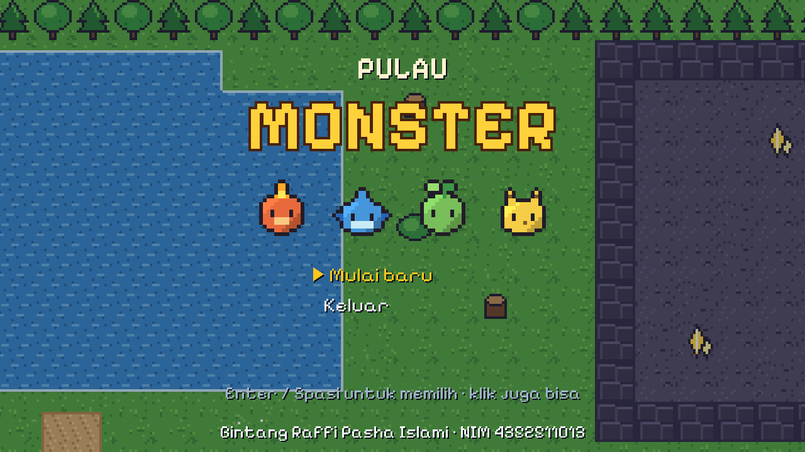
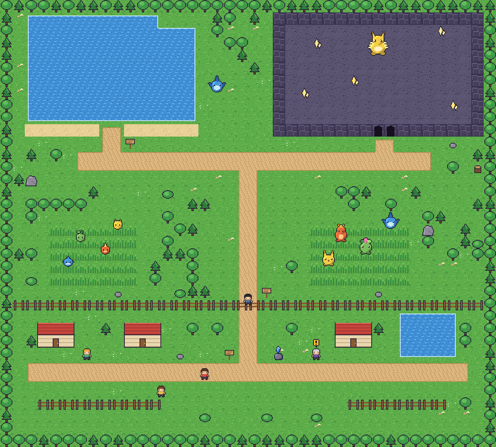
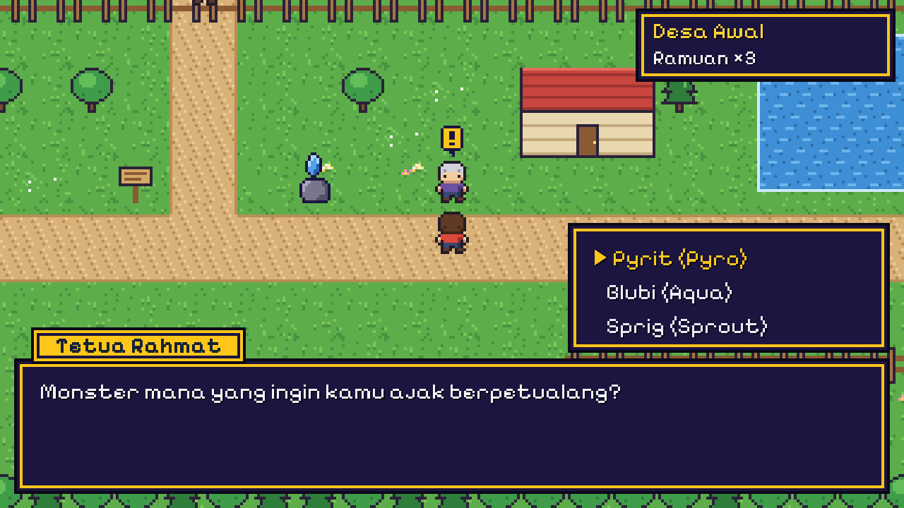
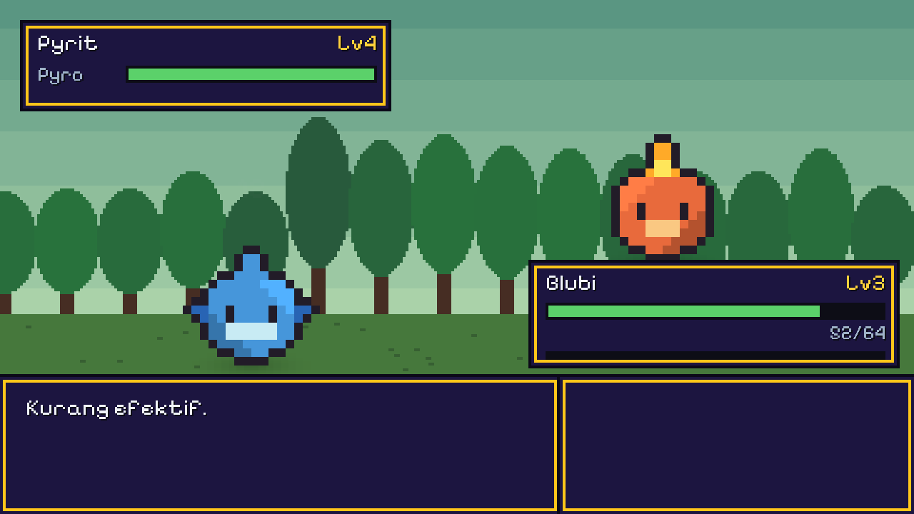
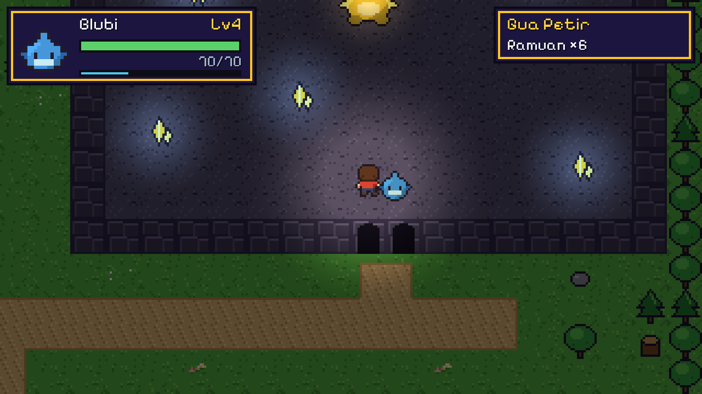
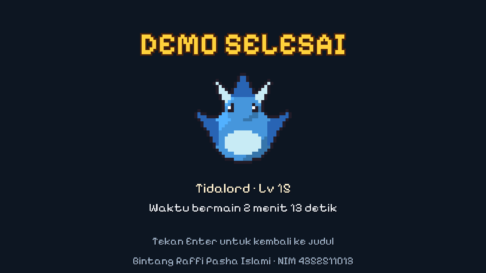

# Pulau Monster — RPG Petualangan 2D (P1–P7)



Proyek praktikum mata kuliah **Proyek Game 2D** — Politeknik Negeri Batam.  
Mengimplementasikan seluruh tahapan **Pertemuan 1 hingga Pertemuan 7** dalam satu game RPG 2D *top-down* bergaya *pixel art* (`320 × 180`, *Pixels Per Unit* 16) dengan pertarungan berbasis giliran (*turn-based battle*).

---

## Identitas Mahasiswa

| Keterangan | Data |
| :--- | :--- |
| **Nama Lengkap** | **Bintang Raffi Pasha Islami** |
| **NIM** | **4352511013** |
| **Branch Repository** | `BintangRaffiPashaIslami_4352511013` |
| **Scene Sandbox Pribadi** | `Assets/_Project/Scenes/Sandbox/Scn_Bintang.unity` |
| **Versi Unity** | `6000.3.24f1` (Universal Render Pipeline 2D) |

---

## Ringkasan Fitur & Peta Dunia (`Scn_World`)



Pemain memulai perjalanan sebagai pelatih muda di **Desa Awal**, memilih satu dari tiga monster *starter* (**Pyrit**, **Blubi**, atau **Sprig**) dari **Tetua Rahmat**, lalu menjelajahi **Hutan Rimbun**, **Danau Sunyi**, hingga menantang boss **Raijugar (Lv 9)** di **Gua Petir**.

| Area | Koordinat & Karakteristik | Elemen Gameplay |
| :--- | :--- | :--- |
| **Desa Awal** | Selatan (`y = 1..11`), pagar pembatas `y = 11` dengan celah `x = 19..20` | Tetua Rahmat (*starter* Lv 3), Pak Dagang (+3 Ramuan), Sari (tips elemen & dialog pasca-boss), Penjaga Batas & `Gate_Hutan`, serta **Batu Simpan** |
| **Hutan Rimbun** | Tengah (`y = 12..24`), 2 petak rumput tinggi (`TM_TallGrass`) | 8 monster liar dengan FSM (*Wander*, *Chase*, *Return*, *Flee*) serta partikel daun `GrassRustle` |
| **Danau Sunyi** | Barat Laut (`x = 2..15, y = 26..34`), tepi pasir & air `RT_Water` | Area perairan tenang dengan monster liar *Aqua* (**Finnox** Lv 4–6) |
| **Gua Petir** | Timur Laut (`x = 22..38, y = 25..34`), `LightZone` redup (`0.15`) | Penerangan `PlayerLight`, 5 lampu `Crystal_*`, serta Boss **Raijugar** Lv 9 |

---

## Kontrol Permainan

| Tombol | Fungsi di Dunia (`Scn_World`) | Fungsi di Menu / Battle (`Scn_Battle`) |
| :--- | :--- | :--- |
| `WASD` / `Arrow Keys` | Berjalan 4 arah | Navigasi pilihan menu |
| `Left Shift` (tahan) | Berlari (*Sprint* `1.6×` / `6 u/d`) | — |
| `E` / `Enter` / `Space` | Interaksi NPC / Batu Simpan & lanjut dialog | Konfirmasi pilihan menu / dialog |
| `Esc` | Membuka / menutup Menu Jeda (*Pause*) | Batal / kembali |
| `M` | *Mute* / *Unmute* seluruh audio | *Mute* / *Unmute* seluruh audio |

---

## Struktur Scene & Arsitektur (`Assets/_Project`)

| Urutan Build | Nama Scene | Deskripsi |
| :---: | :--- | :--- |
| `0` | `Assets/_Project/Scenes/Scn_Bootstrap.unity` | Inisialisasi layanan tunggal (`GameBootstrap`, `GameServices`, `SceneFlow`, `AudioService`, `DialogueRunner`, `PauseMenu`, `ToastView`) |
| `1` | `Assets/_Project/Scenes/Scn_Title.unity` | Layar judul beranimasi dengan opsi **Lanjutkan**, **Mulai baru**, dan **Keluar** |
| `2` | `Assets/_Project/Scenes/Scn_World.unity` | Peta utama `40 × 36` tile (4 layer Tilemap: `TM_Ground`, `TM_Decor`, `TM_Blocking`, `TM_TallGrass`) |
| `3` | `Assets/_Project/Scenes/Scn_Battle.unity` | Pertarungan *turn-based* (**Serang**, **Jurus**, **Ramuan**, **Lari**) lengkap dengan *hit-stop*, *camera shake*, & evolusi |
| `4` | `Assets/_Project/Scenes/Scn_End.unity` | Layar penutup **DEMO SELESAI** yang menampilkan partner akhir, waktu bermain, dan kredit mahasiswa |
| — | `Assets/_Project/Scenes/Sandbox/Scn_Bintang.unity` | Scene *sandbox* pribadi (P1) dengan batas arena, 3 rintangan, NPC statis, dan `MonsterDebugger` |

> **Catatan Editor (`PlayFromBootstrap`)**: Menekan tombol **Play** dari scene mana pun di Unity Editor akan otomatis menjalankan `Scn_Bootstrap` terlebih dahulu (kecuali scene di dalam folder `Sandbox/`).

---

## Cuplikan Layar Permainan

| Pemilihan Partner | Pertarungan & Jurus Elemen |
| :---: | :---: |
|  |  |
| **Gua Petir (`LightZone` 2D)** | **Layar Tamat (`DEMO SELESAI`)** |
|  |  |

---

## Cara Membuka & Build Proyek

1. Buka **Unity Hub**, klik **Add -> Add project from disk**, lalu pilih folder `game_2D_Proj1` (menggunakan Unity **`6000.3.24f1`**).
2. Untuk merakit ulang seluruh aset dan scene secara otomatis dari Editor, pilih menu **Pulau Monster → Rakit Ulang Semua (aset + scene)**.
3. Untuk membuat file *executable* Windows 64-bit, pilih menu **Pulau Monster → Build Windows (.exe)** atau jalankan langsung hasil build di:
   ```text
   Builds/PulauMonster_Win/PulauMonster.exe
   ```
